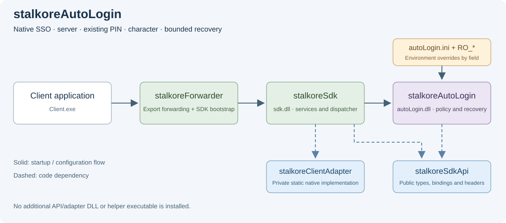

# stalkoreAutoLogin

**Automatic login through SDK-owned client services.**

A Windows x86 plugin that follows the client's native authentication flow,
selects a server and occupied character, enters an existing PIN and coordinates
bounded recovery. The portable policy owns decisions; stalkoreSdk owns native
operations and scheduling through the public
[stalkoreSdkApi](https://github.com/Stalkore/stalkoreSdkApi) contract.

[Quick start](docs/getting-started.md) · [Configuration](docs/configuration.md) ·
[Architecture](docs/architecture.md) · [Validation](docs/validation.md)



## Configure once, launch normally

Create `SDK/autoLogin.ini` beside `autoLogin.dll` from the
[empty example](sdk-plugin/autoLogin.example.ini), retain its automation settings
and fill the local login section:

```ini
[login]
username =
password =
server = 0
character = 0
pin =
```

A defined `RO_USERNAME`, `RO_PASSWORD`, `RO_SERVER`, `RO_CHAR` or `RO_PIN`
overrides only its corresponding field. Invalid overrides fail validation.
The local INI is ignored by Git, and login values never enter logs.
See [configuration](docs/configuration.md) for syntax, bounds and priority.

## Build

The source builds with the public contract and registry dependencies; private
SDK and adapter sources are not required. Running the plugin requires a
compatible SDK runtime and supported client.

```powershell
git clone https://github.com/Stalkore/stalkoreAutoLogin.git
Set-Location '.\stalkoreAutoLogin\sdk-plugin'
rustup target add i686-pc-windows-msvc
cargo build --locked --release --target i686-pc-windows-msvc --jobs 1 --lib
if ($LASTEXITCODE -ne 0) { throw 'Plugin build failed.' }
```

The output is `sdk-plugin/target/i686-pc-windows-msvc/release/autoLogin.dll`.
Follow the [quick start](docs/getting-started.md) to install it without
overwriting local settings.

## Behavior and evidence

| Capability | Behavior |
| --- | --- |
| Login | Native SSO and account-name preparation through SDK operations |
| Selection | Returned server list and occupied character-slot validation |
| PIN | Four existing digits through logical keypad commands |
| Recovery | Close supported notices after X, limit attempts to Y, wait T between submissions |
| Scheduling | One SDK-owned dispatcher; no second native hook |
| Compatibility | Stable DLL/configuration filenames and startup/status aliases |

A consumer-built stack reached map mode using only `autoLogin.ini` on
**2026-11-18 at 19:00:33.053 (UTC−03:00), on attempt 1/3**. Environment-based
startup was observed separately. The [validation record](docs/validation.md)
identifies the tested binary and distinguishes those observations from tests of
the subsequent source reorganization.

## Read by task

| Guide | Purpose |
| --- | --- |
| [Documentation map](docs/README.md) | Choose a reading path |
| [Quick start](docs/getting-started.md) | Build, install, configure and launch |
| [Configuration](docs/configuration.md) | Login sources, priority, syntax and settings |
| [Recovery and PIN](docs/recovery.md) | Timers, attempt budgets and manual states |
| [Architecture](docs/architecture.md) | Follow dependencies, modules and native ownership |
| [Tests](docs/testing.md) | Run portable policy and actual-DLL checks |
| [Migration](docs/migration.md) | Organization, crate layout and retained runtime contracts |
| [Contributing](docs/contributing.md) | Design principles, verification and source hygiene |
| [Validation](docs/validation.md) | Inspect live evidence and its limits |
| [Client updates](docs/client-updates.md) | Restore adapter compatibility and validate login after an executable update |

The root crate is `stalkore-autologin`; `sdk-plugin/` produces `autoLogin.dll`
from `stalkore-autologin-plugin`. No plugin executable or extra adapter DLL is
installed. Client-specific native implementations remain in the private adapter.

[MIT license](LICENSE).
