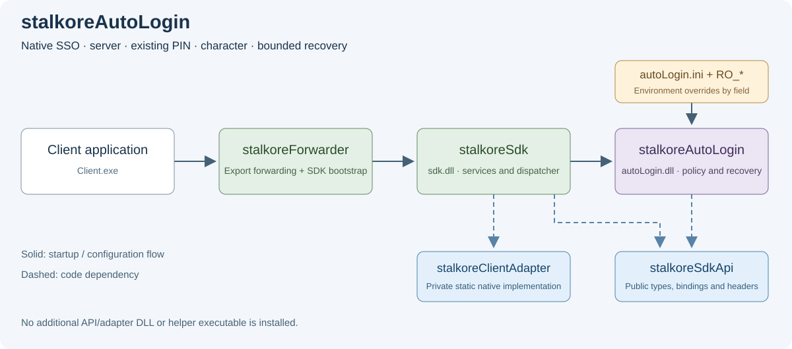
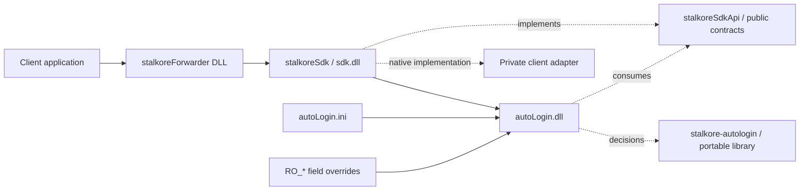

# Architecture

[Documentation](README.md) · [Configuration](configuration.md) · [Tests](testing.md)

## Dependencies and startup

Solid arrows describe loading/configuration. Dashed arrows describe source
dependencies; contract bindings and native implementation are not extra DLLs.

The SDK publishes service tables before plugin startup. The plugin pins its
code, checks capabilities, reads adjacent configuration and subscribes to the
SDK scheduler. The SDK owns supported-client validation and one dispatcher.
READY/TICK execute policy on the owning UI thread; terminal events may run on
the SDK worker.

Native SSO, retained credential buffers, PIN commands and character guards are
adapter responsibilities. Public code receives logical snapshots and opaque
tokens. It does not read client memory or create an authentication connection.

## Module ownership

| Path | Responsibility |
| --- | --- |
| `src/configuration.rs`, `configuration/login.rs` | File snapshot, source priority, literal values and validation |
| `src/client.rs` | ClientOperations seam for production and deterministic test adapters |
| `src/actions.rs` | Logical action names and credential buffer bounds |
| `src/engine.rs` | Phase observation, action selection and progression |
| `src/engine/dispatch.rs` | One logical dispatch, submission budget and character errors |
| `src/engine/recovery.rs` | Dialog acknowledgment and stalled-connection guards |
| `src/engine/pin.rs` | Existing-PIN validation and one-attempt lifetime |
| `src/recovery.rs` | Monotonic timers and bounded attempt budget |
| `sdk-plugin/src/lib.rs` | Canonical and compatibility C exports |
| `sdk-plugin/src/runtime.rs` | First-result retention, status and process-lifetime context |
| `sdk-plugin/src/runtime/startup.rs` | Pinning, module-relative files and SDK subscription |
| `sdk-plugin/src/runtime/events.rs` | READY initialization, TICK progression and terminal status |
| `sdk-plugin/src/runtime/client.rs` | Public SDK adapter implementing ClientOperations |
| `sdk-plugin/src/diagnostics.rs` | Append logging, recursion guard and Win32 error preservation |

Policy is independent of filesystem and native execution. Configuration receives
a file snapshot; source selection accepts an environment lookup, which tests
replace with synthetic values. Credential-owning types have no Debug
implementation, and parser failures become static diagnostics.

## Extension and maintenance

ClientOperations has real SDK and mock implementations. A different host can
implement that seam without changing login decisions. The fixed field priority
and finite phase mapping remain explicit; they do not need discovery registries.
Native provider registries belong to the SDK.

Recovery and dispatch are separate implementation modules of the same policy.
They share one state and clock; splitting source does not introduce independent
loops, hooks or retry budgets. Only observed map entry renews attempts and PIN.

## Ordering and lifetime

- Startup acknowledgment means subscription acceptance; map entry is separate.
- SDK callbacks and the plugin context have process lifetime.
- Nested native message pumping must not deadlock or advance policy twice.
- Acknowledgment can retire objects; return and obtain a new snapshot.
- Wait for asynchronous SSO completion before resetting or resubmitting.
- Partial PIN dispatch consumes its automatic attempt until map entry.
- Changing the file or environment requires a new client process.

The private compatibility library retains old native carrier behavior. It is
outside this repository and is not linked by the production plugin.
Future UI and other plugins can use the same public contract, but this module's
tests establish only its own paths. See [migration](migration.md).
